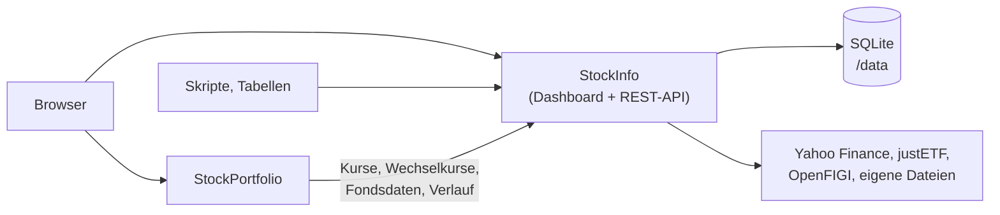

<div align="center">


# StockInfo

**Selbst betriebene Aktien- und ETF-Kurse mit REST-API und Web-Dashboard.**

[English](README.md) · Deutsch

[Funktionen](#funktionen) · [Schnellstart](#schnellstart) · [Konfiguration](#konfiguration) · [Docker-Anleitung](docker/README.md) · [Entwicklerdoku](docs/development.md)

</div>

StockInfo holt Aktien- und ETF-Kurse, speichert sie in einer lokalen
Datenbank und liefert sie als JSON aus. Abgefragt wird per ISIN oder per
Symbol und Börse; die Antwort enthält Preis, Währung, Zeitpunkt, Name und bei
ETFs Kennzahlen wie TER, Anbieter und Fondsgröße.

Ein Web-Dashboard zeigt deine Instrumente, Kursverläufe und Fondskennzahlen,
auf Deutsch und Englisch. Skripte, Tabellenkalkulationen und andere Apps
nutzen die REST-API.


_Die Seite **Assets**: jedes Instrument mit letztem Kurs und Kennzahlen. Der
Kursverlauf der gewählten Zeile ist unten angedockt._

> [!WARNING]
> StockInfo hat keine Anmeldung: Wer es erreicht, kann seine Daten ändern
> oder löschen. Stell es nicht ins Internet. Betreibe es nur im Heimnetz und
> verbinde dich von außen per VPN, zum Beispiel mit WireGuard oder Tailscale.

## Übersicht

- [Funktionen](#funktionen)
- [Datenquellen](#datenquellen)
- [StockPortfolio: die Schwester-App](#stockportfolio-die-schwester-app)
- [Schnellstart](#schnellstart)
- [Konfiguration](#konfiguration)
- [Entwicklung](#entwicklung)
- [Weitere Dokumentation](#weitere-dokumentation)
- [Support](#support)
- [Lizenz](#lizenz)

## Funktionen

- **Kurse per ISIN oder Symbol** – europäische und US-Aktien und -ETFs; die
  bevorzugte Börse ist einstellbar (Vorgabe Xetra).
- **Automatische Aktualisierung** – ein Hintergrundjob aktualisiert alle
  bekannten Instrumente in einem festen Abstand; wiederholte Anfragen kommen
  aus der lokalen Datenbank.
- **Kursverlauf** – eine Intraday-Kurve und Tagesschlusskurse von einer Woche
  bis „Max“.
- **Fonds- und Aktienkennzahlen** – Volumen und Ein-Jahres-Volatilität; bei
  ETFs außerdem TER, Anbieter, Replikation, Fondsgröße, Domizil,
  Fondswährung und Ertragsverwendung.
- **[Eigene Werte](#eigene-werte)** – trag ein, was keine Quelle liefert; ein
  Wert aus der Quelle hat immer Vorrang.
- **Seite Assets** – sortierbare Spalten, Links zum Profil jedes Instruments
  bei extraETF und Yahoo Finance und die JSON-Antwort jeder Abfrage zum
  Kopieren.
- **Wechselkurse** – die Seite **Devisen** und `GET /fx` rechnen zwischen
  Währungen um.
- **Live-Analyse** – die Seite **Analyse** misst jede konfigurierte Quelle
  Rolle für Rolle, am Cache vorbei.
- **Handelsplätze** – die Seite **Börsen** listet Börsensuffixe, Regionen und
  Währungen.
- **Einstellungen** – **Darstellung** (14 Themes), **Sprache** (Deutsch,
  Englisch oder wie der Browser), **API & Links**, **Backup** der Datenbank,
  **Environment** (aktuelle Konfiguration) und **About**.
- **Einstellbare Quellen und Plugins** – Standardquellen ersetzen oder
  ergänzen, oder mit einer selbst gepflegten Datei arbeiten.

### Eigene Werte

Was die Quellen nicht liefern, trägst du im aufklappbaren Detailbereich
einer Zeile von Hand ein. Ein eigener Wert füllt eine Lücke und überschreibt
nie einen Wert aus der Quelle; er gilt wieder, sobald die Quelle keinen mehr
liefert. Das ist der vorgesehene Weg für TER und Fondsgröße von ETFs
außerhalb Europas, die keine freie Quelle verlässlich angibt.


[↑ Übersicht](#übersicht)

## Datenquellen

Die Standardeinrichtung nutzt diese kostenlosen Quellen:

| Quelle | Wofür |
|---|---|
| **Yahoo Finance** | Preise, Währung, Volumen, Name und Tagesschlusskurse für Aktien und ETFs; Fondsanbieter für ETFs außerhalb Europas |
| **justETF** | Kennzahlen europäischer (UCITS-)ETFs: TER, Anbieter, Replikation, Fondsgröße in Millionen EUR, Ein-Jahres-Volatilität, Ertragsverwendung |
| **OpenFIGI** | findet das Listing einer ISIN an deiner bevorzugten Börse |
| **Yahoo-Suche** | Rückfallweg, wenn OpenFIGI ein Instrument nicht auflöst |

Die Quellen stehen in `sources.yaml` neben der Datenbank. Eine mitgelieferte
Dateiquelle kann selbst gepflegte Daten liefern, als Rückfall oder allein.

Siehe [Quellenkonfiguration](docs/plugins.md) und die
[Anleitung für Plugin-Autoren](docs/plugin-authors.md).

**Keine offiziellen APIs.** justETF und Yahoo Finance bieten für diese Daten
keine öffentliche API an. StockInfo liest ihre öffentlichen Webseiten über
die Open-Source-Bibliotheken `justetf-scraping` und `yfinance`. Die
Nutzungsbedingungen von justETF verbieten zum Beispiel automatisierte
Kursabfragen und übermäßige Last.

StockInfo holt von justETF keine Kurse, nur Fondsdaten: einmal je ETF alle
`METADATA_TTL_DAYS` (Vorgabe 7) und zusätzlich, wenn du ein einzelnes
Instrument von Hand aktualisierst.

Wer StockInfo betreibt, ist dafür
verantwortlich, diese Quellen im Rahmen der Bedingungen der Anbieter zu
nutzen.

Wer sie vermeiden will, nimmt sie aus `sources.yaml` heraus oder
verwendet das reine Dateiprofil.

[↑ Übersicht](#übersicht)

## StockPortfolio: die Schwester-App

StockInfo läuft für sich allein. Das optionale
[StockPortfolio](https://github.com/MikeMitterer/stockportfolio) verwaltet
deine eigenen Depots: Es bewertet deine Positionen, zeigt, wie weit sie von
ihrer Zielaufteilung entfernt sind, und berechnet Umschichtungen. Für jeden
Kurs, Wechselkurs und jede Fondskennzahl braucht es StockInfo.



| | StockInfo | StockPortfolio |
|---|---|---|
| Zweck | Kurse, Kursverlauf, Fondskennzahlen | Depots, Bewertung, Rebalancing |
| Läuft allein | Ja | Nein – braucht StockInfo |
| Docker-Image | [`mangolila/stockinfo`](https://hub.docker.com/r/mangolila/stockinfo) | [`mangolila/stockportfolio`](https://hub.docker.com/r/mangolila/stockportfolio) |

Richte zuerst StockInfo ein, dann StockPortfolio.

Wie du StockPortfolio auf deine StockInfo-Adresse zeigen lässt, erklärt
dessen [Einrichtungsanleitung](https://github.com/MikeMitterer/stockportfolio#setup).

[↑ Übersicht](#übersicht)

## Schnellstart

Du brauchst Docker. Das Image enthält Backend, Dashboard und alle
Abhängigkeiten.

```bash
docker run -d \
  --name stockinfo \
  --restart unless-stopped \
  -p 127.0.0.1:8000:8000 \
  -v stockinfo-data:/data \
  mangolila/stockinfo:latest
```

Öffne <http://localhost:8000/> für das Dashboard und
<http://localhost:8000/docs> für die interaktive API-Dokumentation. Eine
erste Abfrage:

```bash
curl http://localhost:8000/quote/IE00B3RBWM25
```

Das Beispiel ist nur vom Docker-Host aus erreichbar. Die
[Docker-Anleitung](docker/README.md) (englisch) erklärt den Zugriff aus dem
Heimnetz, Docker Compose, Daten und Berechtigungen, Updates, Backups und
Sicherheit.

Für Unraid siehe die [Unraid-Anleitung](unraid/README.md) (englisch).

[↑ Übersicht](#übersicht)

## Konfiguration

| Einstellung | Vorgabe | Bedeutung |
|---|---|---|
| Port `8000/tcp` | `8000` | Dashboard und REST-API; auf einen beliebigen Host-Port abbilden |
| Volume `/data` | – | Datenbank, Quellenkonfiguration und Backups; beim Update behalten |
| `DEFAULT_EXCHANGE` | `XETR` | bevorzugte Börse für ISIN-Abfragen (MIC) |
| `REFRESH_INTERVAL_HOURS` | `6` | Abstand der Hintergrundaktualisierung |
| `OPENFIGI_API_KEY` | leer | optionaler Schlüssel für ein höheres OpenFIGI-Limit |

Alle Einstellungen beschreibt die [Docker-Anleitung](docker/README.md#configuration).

[↑ Übersicht](#übersicht)

## Entwicklung

Einrichtung, Befehle, die Referenz der REST-API, Tests und der
Release-Ablauf stehen in der [Entwicklerdoku](docs/development.md)
(englisch).

[↑ Übersicht](#übersicht)

## Weitere Dokumentation

- [Docker-Anleitung](docker/README.md) – Einrichtung, Konfiguration, Sicherheit, Backups und Updates des Containers (englisch)
- [Unraid-Anleitung](unraid/README.md) – Installation über Unraid Apps (englisch)
- [Quellenkonfiguration](docs/plugins.md) – Quellenketten, Dateiquelle und Plugins
- [Anleitung für Plugin-Autoren](docs/plugin-authors.md) – eine eigene Quelle schreiben (englisch)
- [REST-Vertrag](docs/rest-core-contract.md) – was die API zusagt
- [Entwicklerdoku](docs/development.md) – Einrichtung, REST-API, Tests und Releases (englisch)
- [Changelog](CHANGELOG.md) und [Release Notes](docs/release-notes.md) – Änderungen je Release

[↑ Übersicht](#übersicht)

## Support

StockInfo ist für den Eigengebrauch des Autors gebaut und wird kostenlos
geteilt.

[Issues](https://github.com/MikeMitterer/stockinfo/issues) und Pull Requests
werden gelesen, ohne Zusage auf Antwort, Fehlerbehebung oder neue Funktion.

[↑ Übersicht](#übersicht)

## Lizenz

Copyright © 2026 Michael Mitterer. **MangoLila GmbH** ist Anbieterin und
Lizenzgeberin.

StockInfo steht unter der **[EUPL 1.2](LICENSE)**, nur Version 1.2. Sie
erlaubt private und gewerbliche Nutzung, Änderungen, Weitergabe, Verkauf und
Hosting ohne kostenpflichtige Lizenz.

Wer StockInfo oder eine geänderte Fassung weitergibt oder als Netzwerkdienst
anbietet, muss die Urheber- und Lizenzhinweise erhalten, Änderungen
kennzeichnen und den zugehörigen Quelltext nach den Copyleft-Regeln der
Lizenz bereitstellen.

Die Gewährleistungs- und Haftungsausschlüsse der EUPL-Artikel 7 und 8 gelten
auch gegenüber Verbrauchern, soweit das Gesetz es zulässt. Zwingende Rechte
bleiben unberührt, darunter die Haftung für Vorsatz, grobe Fahrlässigkeit,
Personenschäden und nach dem Produkthaftungsgesetz. Eine zusätzliche Garantie
wird nicht übernommen.

Das unabhängige Paket [`plugin_api/`](plugin_api/) steht weiter unter
[MIT](plugin_api/LICENSE). Komponenten Dritter behalten ihre eigenen
Lizenzen.

Kontakt: **office@MangoLila.at**.

Details: [LICENSE](LICENSE) · [Deutscher Lizenztext](LICENSE.de.txt) ·
[Anbieter- und Verbrauchererklärung](LICENSING.md) · [Hinweise zu
Fremdkomponenten](THIRD_PARTY_NOTICES.md)

[↑ Übersicht](#übersicht)
