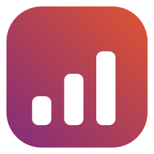
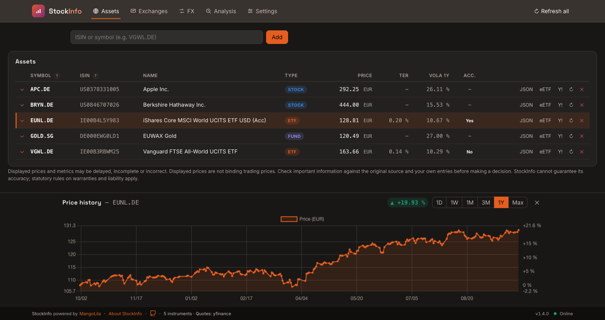
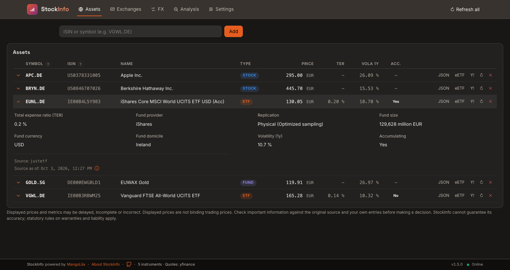
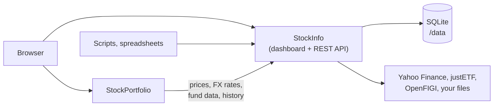

<div align="center">



# StockInfo

**Self-hosted stock and ETF quotes with a REST API and a web dashboard.**

English · [Deutsch](README.de.md)

[Features](#features) · [Quick start](#quick-start) · [Configuration](#configuration) · [Docker guide](docker/README.md) · [Developer guide](docs/development.md)

</div>

StockInfo fetches stock and ETF quotes, keeps them in a local database and
serves them as JSON. You query by ISIN or by symbol and exchange; the answer
contains price, currency, time, name and, for ETFs, metrics such as TER,
provider and fund size.

A web dashboard shows your instruments, price charts and fund metrics, in
English and German. Scripts, spreadsheets and other apps use the REST API.



_The **Assets** page: every instrument with its latest price and metrics. The
price history of the selected row is docked at the bottom._

> [!WARNING]
> StockInfo has no login: anyone who can reach it can change or delete its
> data. Do not put it on the internet. Run it only in your home network and
> connect from outside through a VPN, for example WireGuard or Tailscale.

## Features

- **Quotes by ISIN or symbol** – European and US stocks and ETFs; the
  preferred exchange is configurable (default Xetra).
- **Automatic updates** – a background job refreshes all known instruments
  at a set interval; repeated requests are answered from the local database.
- **Price history** – an intraday curve and end-of-day closes from one week
  to "max".
- **Fund and stock metrics** – volume and 1-year volatility; for ETFs also
  TER, provider, replication, fund size, domicile, fund currency and
  distribution policy.
- **[Your own values](#your-own-values)** – fill in what no source provides;
  a source value always takes precedence.
- **Assets page** – sortable columns, links to each instrument's profile on
  extraETF and Yahoo Finance, and the JSON answer of each request to copy.
- **Exchange rates** – the **FX** page and `GET /fx` convert between
  currencies.
- **Live analysis** – the **Analysis** page measures each configured source
  role by role, bypassing the cache.
- **Trading venues** – the **Exchanges** page lists exchange suffixes, regions
  and currencies.
- **Settings** – **Appearance** (14 themes), **Language** (English, German,
  or follow the browser), **API & Links**, **Backups** of the database,
  **Environment** (current configuration) and **About**.
- **Configurable sources and plugins** – replace or extend the default
  sources, or run on a file you maintain yourself.

### Your own values

Whatever the sources do not deliver can be entered by hand in the expandable
detail area of a row. A manual value fills a gap and never overwrites a
source value; it applies again as soon as the source stops providing one.
This is the intended route for TER and fund size of ETFs outside Europe,
which no free source states reliably.



## Data sources

The default setup uses these free sources:

| Source | Used for |
|---|---|
| **Yahoo Finance** | prices, currency, volume, name and daily closes for stocks and ETFs; fund provider for ETFs outside Europe |
| **justETF** | metrics of European (UCITS) ETFs: TER, provider, replication, fund size in millions of EUR, 1-year volatility, distribution policy |
| **OpenFIGI** | finds the listing of an ISIN at your preferred exchange |
| **Yahoo search** | fallback when OpenFIGI cannot resolve an instrument |

Sources are set in `sources.yaml` next to the database. A bundled file source
can supply data you maintain yourself, as a fallback or on its own. See
[source configuration](docs/plugins.md) and the
[plugin author guide](docs/plugin-authors.md).

**No official APIs.** justETF and Yahoo Finance offer no public API for this
data. StockInfo reads their public web pages through the open-source
libraries `justetf-scraping` and `yfinance`. justETF's terms of use, for
example, forbid automated price queries and excessive load.

StockInfo fetches no prices from justETF, only fund data: once per ETF every
`METADATA_TTL_DAYS` (default 7), plus when you refresh a single instrument by
hand. Whoever runs StockInfo is responsible for using these sources in line
with the providers' terms. To avoid them, remove them from `sources.yaml` or
use the file-only profile.

## StockPortfolio: the companion app

StockInfo works on its own. The optional
[StockPortfolio](https://github.com/MikeMitterer/stockportfolio) manages your
own portfolios: it values your positions, shows how far they are from their
target allocation and calculates rebalancing trades. It needs StockInfo for
every price, exchange rate and fund metric.



| | StockInfo | StockPortfolio |
|---|---|---|
| Purpose | Quotes, price history, fund metrics | Portfolios, valuation, rebalancing |
| Runs on its own | Yes | No – needs StockInfo |
| Docker image | [`mangolila/stockinfo`](https://hub.docker.com/r/mangolila/stockinfo) | [`mangolila/stockportfolio`](https://hub.docker.com/r/mangolila/stockportfolio) |

Set up StockInfo first, then StockPortfolio.

StockPortfolio's [setup guide](https://github.com/MikeMitterer/stockportfolio#setup)
explains how to point it at your StockInfo address.

## Quick start

You need Docker. The image contains the backend, the dashboard and all
dependencies.

```bash
docker run -d \
  --name stockinfo \
  --restart unless-stopped \
  -p 127.0.0.1:8000:8000 \
  -v stockinfo-data:/data \
  mangolila/stockinfo:latest
```

Open <http://localhost:8000/> for the dashboard and
<http://localhost:8000/docs> for the interactive API documentation. A first
query:

```bash
curl http://localhost:8000/quote/IE00B3RBWM25
```

The example is reachable only from the Docker host. The
[Docker guide](docker/README.md) explains access from your home network,
Docker Compose, data and permissions, updates, backups and security.

For Unraid, see the [Unraid guide](unraid/README.md).

## Configuration

| Setting | Default | Meaning |
|---|---|---|
| Port `8000/tcp` | `8000` | Dashboard and REST API; map it to any host port |
| `/data` volume | – | Database, source configuration and backups; keep it when updating |
| `DEFAULT_EXCHANGE` | `XETR` | Preferred exchange for ISIN queries (MIC code) |
| `REFRESH_INTERVAL_HOURS` | `6` | Interval of the background refresh |
| `OPENFIGI_API_KEY` | empty | Optional key for a higher OpenFIGI rate limit |

All settings are described in the [Docker guide](docker/README.md#configuration).

## Development

Setup, commands, the REST API reference, tests and the release process are
described in the [developer guide](docs/development.md).

## Further documentation

- [Docker guide](docker/README.md) – container setup, configuration, security, backups and updates
- [Unraid guide](unraid/README.md) – installation through Unraid Apps
- [Source configuration](docs/plugins.md) – source chains, file source and plugins (German)
- [Plugin author guide](docs/plugin-authors.md) – writing your own source
- [REST contract](docs/rest-core-contract.md) – what the API promises (German)
- [Developer guide](docs/development.md) – setup, REST API, tests and releases
- [Changelog](CHANGELOG.md) and [release notes](docs/release-notes.md) – changes per release

## Support

StockInfo is built for its author's own use and shared free of charge.

[Issues](https://github.com/MikeMitterer/stockinfo/issues) and pull requests
are read, but there is no promise of a reply, a fix or a new feature.

## License

Copyright © 2026 Michael Mitterer. **MangoLila GmbH** is the provider and
licensor.

StockInfo is licensed under the **[EUPL 1.2](LICENSE)**, version 1.2 only.
It permits personal and commercial use, changes, redistribution, sale and
hosting without a paid license.

If you redistribute StockInfo or a changed version, or offer it as a network
service, keep the copyright and license notices, mark your changes and
provide the corresponding source under the license's copyleft rules.

The warranty and liability exclusions in EUPL Articles 7 and 8 also apply to
consumers, as far as the law permits. Mandatory rights remain unaffected,
including liability for intent, gross negligence, personal injury and product
liability. No additional guarantee is given.

The independent [`plugin_api/`](plugin_api/) package remains under
[MIT](plugin_api/LICENSE). Third-party components retain their own
licenses.

Contact: **office@MangoLila.at**.

Details: [LICENSE](LICENSE) · [German license text](LICENSE.de.txt) ·
[Provider and consumer declaration](LICENSING.md) · [Third-party
notices](THIRD_PARTY_NOTICES.md)
