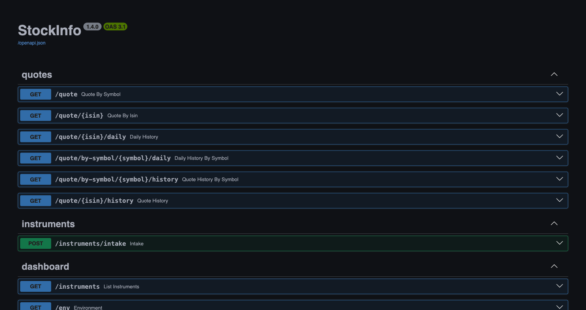

# StockInfo

Stock and ETF quotes, price history and a web dashboard in one container.
By default, StockInfo fetches market data from Yahoo Finance and justETF,
resolves ISINs with OpenFIGI, and caches results in SQLite. Sources are
configurable and can be replaced by plugins. The dashboard supports English
and German; the REST API returns JSON for use by other applications.

**GitHub:** [MikeMitterer/stockinfo — source code and documentation](https://github.com/MikeMitterer/stockinfo)

**No login:** anyone who can reach StockInfo can change or delete its data.
Do not put it on the internet. Use it only in your home network. From
outside, connect to your home network with a VPN, for example WireGuard or
Tailscale.


## StockPortfolio: the companion app

StockInfo works on its own. Scripts, spreadsheets and other apps can use its
quotes through the REST API; no second container is needed.

[StockPortfolio](https://hub.docker.com/r/mangolila/stockportfolio) is an
optional addition for managing your own portfolio. It was built as a
companion to StockInfo: it values your positions, shows how far they are from
their target allocation and calculates rebalancing trades. Prices, exchange
rates and fund metrics come from StockInfo.

To use both, start StockInfo first, then the `mangolila/stockportfolio`
container with `STOCKINFO_API_URL` set to your StockInfo address.

Details are in its [Docker guide](https://hub.docker.com/r/mangolila/stockportfolio)
([source code](https://github.com/MikeMitterer/stockportfolio)).

## Quick start

You need Docker. The image includes the backend, dashboard and dependencies.

```bash
docker run -d \
  --name stockinfo \
  --restart unless-stopped \
  -p 127.0.0.1:8000:8000 \
  -v stockinfo-data:/data \
  mangolila/stockinfo:latest
```

Open **http://localhost:8000/** for the dashboard or
**http://localhost:8000/docs** for the interactive API documentation.

```bash
curl http://localhost:8000/quote/IE00B3RBWM25
```

The example exposes the service only on the Docker host. To reach it from
your home network, replace `127.0.0.1:8000:8000` with `8000:8000` and use the
host's address in your browser. Keep that port inside your home network.

## Docker Compose

Save this as `compose.yaml` in a directory of your choice:

```yaml
services:
  stockinfo:
    image: mangolila/stockinfo:latest
    restart: unless-stopped
    ports:
      - "127.0.0.1:8000:8000"
    volumes:
      - stockinfo-data:/data
    environment:
      TZ: Europe/Vienna
      DEFAULT_EXCHANGE: XETR
      CACHE_TTL_HOURS: "6"
      REFRESH_INTERVAL_HOURS: "6"

volumes:
  stockinfo-data:
```

Start it with `docker compose up -d`. This is an alternative to the
`docker run` example; Compose creates its own project-scoped data volume.

## What you get

- Stock and ETF quotes by ISIN or symbol and exchange.
- Cached prices, automatic refreshes and historical price charts.
- ETF metadata such as TER, provider and fund size (in millions of EUR) when the
  source supplies it.
- Manual values for metadata that the sources do not provide, in an expandable
  detail area per row:

  

- A dashboard for managing instruments, viewing charts and configuring sources.
  A short note below the asset list states the limits of the displayed data.
- An **About** tab under Settings, also linked from the status bar, explains
  the limits of the displayed data and links to the license documents.
- A REST API on the same port as the dashboard.



Online sources need outbound internet access and can impose rate limits or
return incomplete data. Source chains are configurable; a bundled YAML-file
source also supports manually maintained data.

**No official APIs.** The default sources justETF and Yahoo Finance do not
offer a public API for this data. StockInfo reads their public web pages through the open-source
libraries `justetf-scraping` and `yfinance`. justETF's terms of use, for
example, forbid automated price queries and excessive load. StockInfo fetches
no prices from justETF, only fund data: once per ETF every `METADATA_TTL_DAYS`
(default 7), plus when you refresh a single instrument by hand. Whoever runs
StockInfo is responsible for using these sources in line with the providers'
terms. To avoid them, remove them from `/data/sources.yaml` or use a file-only
source profile.

## Storage and permissions

Mount persistent storage at **`/data`**. It contains the SQLite database
(`/data/stockinfo.db`), source configuration and other application data.
Keep this volume when replacing or updating the container.

For a host directory instead of a named volume, use a mount such as
`-v /srv/stockinfo:/data`. Mount a directory dedicated to StockInfo.

The container starts as root only to prepare `/data`, then runs the
application as **UID 99 / GID 100** (Unraid's `nobody:users`). The
entrypoint changes ownership only when files belong to someone else. Before the app starts, it checks that `/data` and an existing database
are writable for the target user:

- If ownership cannot be changed (for example on NFS/SMB), it logs a warning
  and continues when the directory is still writable.
- If the directory or database is not writable, or the container lacks the
  `SETUID`/`SETGID` capabilities, it stops with a message naming the path,
  the IDs and the fix.
- With `--user UID:GID` it skips the ownership step and only checks that
  `/data` is writable for that user.

Source chains live in `/data/sources.yaml` and are loaded at startup. Restart
the container after editing them. See the [source configuration guide](../docs/plugins.md)
for file-based sources and plugins; paths described there beside the database
belong under `/data` in the container.

## Configuration

Pass settings with `docker run -e NAME=value`, an `--env-file`, or Compose's
`environment` section. Restart/recreate the container to apply changed settings.

| Variable | Default | Purpose |
|---|---|---|
| `TZ` | Container default | Timezone, for example `Europe/Vienna` |
| `CACHE_TTL_HOURS` | `6` | Quote age that triggers a refresh on request |
| `REFRESH_INTERVAL_HOURS` | `6` | Background refresh interval |
| `METADATA_TTL_DAYS` | `7` | ETF metadata refresh interval |
| `DEFAULT_EXCHANGE` | `XETR` | Preferred exchange for ISIN queries (MIC code) |
| `STRICT_EXCHANGE` | `false` | Require that exchange during ISIN resolution |
| `FX_TTL_HOURS` | `1` | Exchange-rate cache lifetime |
| `OPENFIGI_API_KEY` | Empty | Optional key for a higher OpenFIGI rate limit |
| `CORS_ORIGINS` | `["http://localhost:5173"]` | Web pages on another address that may call the API, as a JSON list; see [Security](#security) |

The container listens on **port 8000**. To use a different host port, change
only the left-hand port in the mapping, for example `127.0.0.1:8080:8000`.
Dashboard and API share an origin; no separate frontend container is needed.

## Security

**StockInfo has no authentication, and it is not meant to have one.** Every
endpoint is open to anyone who can reach the port, including the ones that
change or destroy data:

- `POST /backups/{name}/restore` replaces the whole database with a backup.
- `DELETE /instruments/{isin}` and `DELETE /instruments/by-symbol/{symbol}`
  remove an instrument together with its entire price history.
- `POST /instruments/intake`, `PUT /instruments/by-symbol/{symbol}/isin`,
  `PUT /instruments/by-symbol/{symbol}/overrides` and
  `PATCH /instruments/by-id/{listing_id}/details` add or change stored data.
- `POST /refresh` (also for one instrument) fetches live data from Yahoo and
  justETF and writes it to the database; `GET /analyze` triggers live
  requests without storing them.

Every host address the port is published on can reach it. To use StockInfo
only on the Docker host, publish the port with `-p 127.0.0.1:8000:8000` and
leave `HOST` unchanged; `HOST=127.0.0.1` inside the container makes the port
unreachable.

**Do not put StockInfo on the internet.** Use it only in your home network.
From outside, connect to your home network with a VPN, for example WireGuard
or Tailscale. Never open StockInfo's port on your router.

`CORS_ORIGINS` is **not** a protection. It restricts what a browser on another
address may do; it does nothing about `curl`, a script or any server-to-server
call. It does keep other web pages open in your browser from reading
StockInfo's answers or deleting data, so list only the addresses you need
instead of `*`.

Two limits exist, and they are about load rather than access: the global
refresh takes a non-blocking lock so two runs cannot overlap, and justETF is
only scraped once every `METADATA_TTL_DAYS` (an explicit single refresh still
forces it).

## Updates, backups and troubleshooting

For Compose installations:

```bash
docker compose pull
docker compose up -d
docker compose logs --tail=100 stockinfo
```

For `docker run` installations, pull the new image, stop and remove the old
container, then repeat your original run command with the **same data mount**.
Use a versioned image tag instead of `latest` if you want to pin a release.
Available tags are listed on Docker Hub.

Back up the whole `/data` volume before updating. For a filesystem copy, stop
the container first so that the SQLite database and its journal files stay
consistent. Keep the backup outside the container and its data volume.

For the `docker run` example, view logs with `docker logs --tail=100 stockinfo`.
The image includes a healthcheck against `/operational`; `/health` checks that
the process is running, and `/ready` reports whether normal requests are allowed.
If the service waits for a migration or reports a source error, inspect the
logs and dashboard before restarting repeatedly.

## Unraid

See the [Unraid guide](../unraid/README.md) for installation, configuration and operation.

## Support and license

StockInfo is built for its author's own use and shared free of charge.
Issues and pull requests are read, but there is no promise of a reply, a fix
or a new feature.

- [Report a problem](https://github.com/MikeMitterer/stockinfo/issues)
- [Source code and full documentation](../README.md)
- [Release notes](../docs/release-notes.md)
- [Changelog by release tag](../CHANGELOG.md)
- [License: EUPL 1.2 only](../LICENSE)

Copyright © 2026 Michael Mitterer. **MangoLila GmbH** is the provider and licensor.

StockInfo is licensed under the **[EUPL 1.2](../LICENSE)**, version 1.2
only. What it permits and requires, the consumer declaration and the contact
are in the [License section of the README](../README.md#license).

In the dashboard, **Settings → About** links to the EUPL in the selected UI
language and to the consumer declaration.

The image includes `/app/LICENSE`, `/app/LICENSE.de.txt` and `/app/LICENSING.md`,
and the MIT licenses of the plugin API at `/app/plugin_api/LICENSE` and
`/app/plugin_api/examples/us-example/LICENSE`. Image tags identify the source
commit in the [source repository](https://github.com/MikeMitterer/stockinfo).
