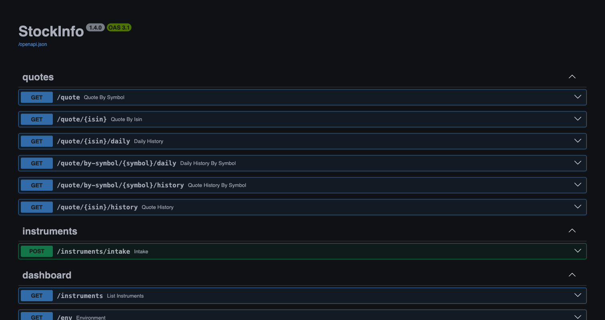

# StockInfo developer guide

How to run StockInfo from a checkout, change it, test it and publish it.
Installing and running the finished container is described in the
[Docker guide](../docker/README.md); what StockInfo does is in the
[README](../README.md).

## Contents

- [Requirements](#requirements)
- [Set up and start](#set-up-and-start)
- [Configuration (.env)](#configuration-env)
- [Dashboard development](#dashboard-development)
- [REST API](#rest-api)
- [Docker image](#docker-image)
- [Tests](#tests)
- [Releases and changelog](#releases-and-changelog)
- [Project layout](#project-layout)

## Requirements

- **Python 3.14 or newer** (`make setup` creates the project `.venv` with
  `python3.14` and replaces an existing `.venv` built with an older Python;
  choose another interpreter with `PYTHON_BOOTSTRAP=python3.15 make setup`)
- **make** (drives setup and start/stop of the services)
- **overmind** and **tmux** for `make dev-up` (backend and dashboard together)
- optional **Docker** (to run the container)
- **Node.js 24+ with npm** (`make setup` installs the dashboard packages;
  the backend and prebuilt Docker image do not use Node.js on the host)
- **pipx** and the **devtools** starter, installed once per machine from a
  local DevTools checkout (its install target); without it `make setup` stops
  and says so. As long as the tools are not published on GitHub or PyPI,
  DevTools takes them from your local repositories through its machine-local
  source mapping.
- **Deno 2** for `make docs-check`

`make setup` installs ProjectTools, BashLib and CLITheme at the versions in
`.dev-tools.conf.sh` into `.tools/` of this checkout; each checkout and
worktree has its own copy. `make help`, `make info`, `make hints` and the
status lines of the other targets come from BashLib and use your CLITheme
theme (`clitheme use NAME`). `make test`, `make check`, `make docs-check`,
`make status`, `make changelog`, `make dev-up`, `make dev-down`, `make push`
and `make tag-*` need ProjectTools in `.tools/`; without it they stop and
name the next step before they start or stop anything. Without ProjectTools, `make hints` shows
`repo-info fehlt` instead of the repository and the last release, and
`dev-ports fehlt` instead of the local addresses. `make setup`
installs BashLib; `help`, `info`, `hints`, `dev-up`, `dev-down`, `up`,
`down`, `build`, `build-check`, `push`, `version`, `tags` and `tag-*` need it.
All of them except `help`, `info` and `hints` stop with `make setup` before
they start or stop anything. To build the
image without these tools, run this instead of `make build`:

```bash
docker build -f docker/Dockerfile -t mangolila/stockinfo:latest .
```

The Docker image needs none of these tools.

[↑ Contents](#contents)

## Set up and start

```bash
# 1. Create the configuration
cp .env.example .env

# 2. Install dependencies (Python .venv, dashboard packages, tools in .tools/, Git hook)
make setup

# 3. Start backend :8000 and dashboard :5173 with auto-reload
make dev-up         # stop with make dev-down · logs with make dev-logs
```

`make setup` can be run again at any time. It keeps an existing `.venv` built
with the required Python version and only installs again when
`requirements.txt`, `requirements-dev.txt`, `dashboard/package-lock.json` or
`.dev-tools.conf.sh` changed. When the minimum version in `requires-python`
rises, test targets ask for `make setup`, which then replaces a `.venv` built
with an older Python. A package
pinned to a Git commit in `requirements.txt` is then reinstalled when the
installed commit differs from the pin, even if the package version stayed
the same. Test targets do not set anything up themselves: after such a change
they stop and ask for `make setup`. `make info` shows whether the tools are
current. `make clean` removes what setup, tests and builds created in the
checkout (`.venv`, dashboard packages, `.tools/`, caches, and `__pycache__`
and `*.egg-info` in `app/`, `tests/`, `scripts/` and `plugin_api/`); `.env`,
everything in `data/` and the build record in `docker/` stay.

`make dev-up` runs both in the background via
[overmind](https://github.com/DarthSim/overmind) (needs overmind and tmux).

overmind loads `.env` into the environment of both processes, so the values
in `.env` apply to the backend.

Each port of the dev stack stands once, where it takes effect at start: the
backend port (8000) as `--port` in the `backend` line of `Procfile.dev`, the
dashboard port (5173) as `server.port` in `dashboard/vite.config.ts`. To
change one, change it only there. `dev-ports` (ProjectTools) reads them from
there; everything else asks it with `dev-ports --port-of`:

- `Procfile.dev` itself, for `PORT` of the backend (so `GET /env` shows the
  port in use, not `PORT` from `.env`, which is the host port of `make up`)
  and for the target of the Vite proxy (`VITE_DEV_API_TARGET`),
- `make info`, `make hints` and the address after `make dev-up`,
- `scripts/sources-profile.sh --show`.

If the dashboard port is taken, Vite stops instead of moving to another one.

Before starting, `make dev-up` checks that overmind and tmux are installed
(otherwise it stops with the install command) and checks the ports with
`dev-ports --check` (ProjectTools in `.tools/`): if one is taken, it stops
and names the process holding it. `make dev-down` stops the stack and uses
`dev-ports --kill` to clean up after a crash: it ends leftover overmind, tmux
and app processes of this project, removes a stale `.overmind.sock` and
frees the ports of the dev stack. It only ends your own processes inside
this project and can be run as often as you like. `dev-ports --status` shows
who holds a port.

If `make dev-up` reports that Overmind is already running, a
`.overmind.sock` exists: either the stack is still running (`make dev-logs`)
or a crash left the file behind, and `make dev-down` removes it.

The server then runs at `http://localhost:8000`. Interactive API docs (Swagger UI,
dark theme) live at `http://localhost:8000/docs` (use `http://` in the browser, not
`https://`). The dashboard runs at `http://localhost:5173`.

First query:

```bash
curl http://localhost:8000/quote/IE00B3RBWM25
```

`make help` lists all available commands. `make hints` shows links, the local
URLs with their ports and everyday tips; `make info` shows paths, ports and
whether the tools are current.

Plugin data migrations run automatically before normal operation when an
active source increases its `data_version`. StockInfo backs up first and commits
each migration together with its new version. Failed or missing migrations
block business requests and refreshes; the server log identifies the plugin,
versions and cause. See [plugin data migrations](plugin-authors.md#plugin-data-migrations).

[↑ Contents](#contents)

## Configuration (.env)

All values can be overridden in `.env`; step 1 of the setup above creates it
from `.env.example`:

| Variable | Meaning | Default |
|---|---|---|
| `HOST` | bind address of the backend started by `make dev-up` | `127.0.0.1` |
| `PORT` | host port of the container started by `make up` | `8000` |
| `DATABASE_PATH` | path of the SQLite file | `data/stockinfo.db` |
| `CACHE_TTL_HOURS` | age at which a quote is re-fetched on request | `6` |
| `REFRESH_INTERVAL_HOURS` | interval of the background refresh | `6` |
| `REFRESH_INTERVAL_MINUTES` | interval in minutes; takes precedence over `REFRESH_INTERVAL_HOURS` | empty |
| `REFRESH_ON_START` | first background refresh right after startup | `true` |
| `METADATA_TTL_DAYS` | refresh cadence for ETF metadata | `7` |
| `DEFAULT_EXCHANGE` | preferred exchange for ISIN queries (MIC) | `XETR` (Xetra) |
| `STRICT_EXCHANGE` | require the preferred exchange when resolving an ISIN | `false` |
| `FX_TTL_HOURS` | cache lifetime for exchange rates | `1` |
| `OPENFIGI_API_KEY` | optional key for a higher OpenFIGI rate limit | empty |
| `EXTRAETF_ETF_URL` / `EXTRAETF_STOCK_URL` | profile link templates (placeholder `{isin}`) | extraetf.com/… |
| `YAHOO_URL` | Yahoo link template (placeholder `{symbol}`) | de.finance.yahoo.com/… |
| `CORS_ORIGINS` | web pages on another address that may call the API, as a JSON list | `["http://localhost:5173"]` |

By default `make dev-up` listens on `127.0.0.1`, so only your own computer
reaches it. `HOST=0.0.0.0` makes it reachable from your network, for example
to test from a phone. The [security model](../docker/README.md#security)
explains what anyone who can reach the port can do. The container always
listens on `0.0.0.0` inside; the port mapping of `docker run` decides who
reaches it.

The settings above are read by `app/config.py`; `make docs-check` reports a
new one until it is described here and in the
[Docker guide](../docker/README.md#configuration).

[↑ Contents](#contents)

## Dashboard development

The web frontend lives in [`dashboard/`](../dashboard/) (Vue 3 + Vite +
TypeScript + SCSS). `make dev-up` starts it together with the backend. To run
it on its own, from the project root (`dev-ports` finds `Procfile.dev`
only there; `make setup` puts it into `.tools/bin`):

```bash
export PATH="$PWD/.tools/bin:$PATH"
VITE_DEV_API_TARGET="http://127.0.0.1:$(dev-ports --port-of backend)" npm run dev --prefix dashboard   # http://localhost:5173
```

The Vite dev proxy forwards API requests to the backend at
`VITE_DEV_API_TARGET`; `make dev-up` sets it from the `backend` line of
`Procfile.dev`. Without it, or with an incomplete value such as
`http://127.0.0.1:` when the port lookup failed, the dev server does not
start and names the command above (`dashboard/vite.config.ts`); otherwise
every API request would get the dashboard page instead of an answer. `VITE_API_BASE_URL`
(`dashboard/src/config.ts`) is not needed in dev. The backend must run in
parallel.

[↑ Contents](#contents)

## REST API



| Method & path | Purpose |
|---|---|
| `GET /health` | liveness — answers as long as the process is alive |
| `GET /ready` | readiness — is normal operation released? `503` with `status` = `degraded` (database unreachable **or** startup failed, told apart by `database`), `migration_pending` or `starting` |
| `GET /operational` | can the process do its current job? The Docker healthcheck hangs on this one. `200` while a migration is pending or the service is starting, `503`/`degraded` only when something is broken |
| `GET /migration` | what a confirmed migration would do — without changing anything |
| `POST /migration/confirm` | run it, once, on explicit confirmation |
| `GET /migration/report` | what actually happened, still available long after |
| `GET /quote/{isin}` | quote by ISIN (prefers Xetra/EUR) |
| `GET /quote?symbol=VGWL.DE` | quote by full Yahoo symbol (suffix = exchange) |
| `GET /quote/{isin}/history` | intraday history (collected ticks) |
| `GET /quote/{isin}/daily?period=1w\|1m\|3m\|1y\|max` | real end-of-day closes (EOD, cached) |
| `GET /fx?base=EUR&quote=USD` | exchange rate: 1 `base` = rate `quote`; `quote_time` is the time the source states, or the fetch time if it states none |
| `GET /instruments` | all cached instruments with their latest quote |
| `POST /instruments/intake` | resolve an identifier and add the instrument; optionally confirm a different exchange before saving |
| `GET /fields` | core and plugin field descriptions, detail schema and schema versions |
| `GET /instrument-types` | declared asset types from the running plugin configuration, including completeness and source status |
| `GET /sources` | configured source chains and local source diagnostics |
| `GET /exchanges` | active exchange catalogue and the support the sources declare, without a live query |
| `GET /analyze?isin=…` · `GET /analyze?symbol=…` | diagnosis: times each live fetch stage for one instrument; makes real external requests |
| `GET /instruments/by-symbol/{symbol}/overrides` · `PUT …` | read / write the key figures added by hand |
| `GET /env` | current configuration (secrets masked) |
| `POST /refresh` · `POST /refresh/{isin}` | refresh all / a single instrument |
| `PUT /instruments/by-symbol/{symbol}/isin` | add an ISIN after the fact |
| `PATCH /instruments/by-id/{listing_id}/details` | set or remove manual detail values |
| `DELETE /instruments/{isin}` | delete an instrument including its history |
| `GET /backups` · `POST /backups` · `POST /backups/{name}/restore` | list backups / create one / schedule a restore (`202`; it takes effect on the next restart) |

For instruments **without an ISIN**, use `GET /quote?symbol=…` for a quote.
History, daily, refresh and delete have `…/by-symbol/{symbol}` variants.
An ambiguous symbol returns `409` with the candidate listings.

For dynamic type filters, read `GET /instrument-types` instead of collecting
types from stored instruments. New plugin types appear without a fixed client
enumeration. Known types remain listed during source outages; `complete: false`
indicates missing or invalid declarations. See the
[type catalog contract](rest-core-contract.md#asset-typen-aus-der-plugin-konfiguration).

**Example response excerpt** (`GET /quote/IE00B3RBWM25`; optional fields omitted):

```json
{
  "identity": {
    "kind": "listed",
    "ticker": "VGWL",
    "mic": "XETR",
    "isin": "IE00B3RBWM25"
  },
  "symbol": "VGWL.DE",
  "exchange": "Xetra",
  "name": "Vanguard FTSE All-World UCITS ETF",
  "type": "etf",
  "currency": "EUR",
  "price": 160.98,
  "quote_time": "2026-07-10T15:35:46+00:00",
  "volume": 14403,
  "ter": 0.19,
  "provider": "Vanguard",
  "replication": "Physical(Optimized sampling)",
  "volatility": 9.95,
  "accumulating": false,
  "source": "yfinance+justetf",
  "cached": false,
  "stale": false,
  "fetched_at": "2026-07-12T18:16:28+00:00"
}
```

Read `identity.kind` before accessing identity fields: listed instruments carry
`ticker` and `mic`, pairs carry `base` and `quote_currency`, and ISIN-only
instruments carry `isin`. Quote and instrument responses also contain a
`details` map with values, units, currencies and provenance. Instruments have
a persistent `listing_id`. See the [REST reference](rest-core-contract.md)
and [detail fields](plugin-authors.md#open-detail-fields).

`volatility` is the 1-year volatility in percent — from justETF for ETFs, otherwise
computed (annualized) from the cached EOD closes. `accumulating` states whether an
ETF accumulates (`true`) or distributes (`false`).

Fields that cannot be determined are `null` (e.g. `ter` for individual stocks). If a
live fetch fails but an old value exists in the cache, that value is returned with
`"stale": true` instead of an error. Unknown ISIN → `404`.

**ETFs outside Europe.** justETF is a database of European UCITS funds, so a
US or Canadian ETF finds nothing there. For those, Yahoo supplies the fund
provider and deliberately nothing else: it reports the expense ratio in two
fields with two different units (`0.03` vs `0.0003` for the same fund) and the
fund size as an absolute amount, while StockInfo keeps fund sizes in millions.
A wrong number would be worse than none, because a value from a source hides
one entered by hand. TER, fund size and domicile therefore stay empty for
those funds until someone enters them.

The exchange suffix selects the exchange; the currency comes from the quote.
The current Yahoo plugin rejects pence codes such as `GBp` instead of
converting them to `GBP`. Yahoo daily prices are adjusted for splits and
dividends. Both behaviors differ from the REST artifact; see the
[known contract differences](rest-core-contract.md#die-begriffe-die-sich-sonst-niemand-erschließt).

[↑ Contents](#contents)

## Docker image

Backend **and** dashboard run in a single image on one port. Built with
`docker/build.sh` (ecosystem convention, versioned via `gitDockerTag`):

```bash
make build         # build the image (docker/build.sh --build)
make build-check   # start the built image once and check it (docker/build.sh --check)
make up            # start the container → http://localhost:8000/
make down          # stop & remove
make docker-logs   # follow logs
```

`make build-check` starts the image recorded by the last `make build` (by its
image ID, so a tag moved since then does not count) the way a user without a
clone does: a throwaway container on a free port on `127.0.0.1`, data in an
anonymous volume, no refresh on start. It passes when `GET /health` reports
`ok` within 30 seconds in total and `/` serves the dashboard. The container
is removed when the check ends, also when a step fails. It never pulls an
image from a registry. Nothing is
installed on the host: the image is the package, started with `docker run`,
Compose or the Unraid template.

On ARM Macs, the dashboard build runs natively; the final image still uses the
platform selected by `PLATFORM` (`linux/amd64` by default for Unraid;
`PLATFORM=arm` selects `linux/arm64`). The checked build publishes one platform
at a time.

FastAPI serves the dashboard itself (relative API calls) — no separate web server
required. `make up` keeps the data in the `stockinfo-data` volume (`/data` inside
the container); the [Docker guide](../docker/README.md#storage-and-permissions)
explains storage and permissions.

To select the file-only source profile **before the first start**, build the
image and write the profile to the same named volume that `make up` mounts:

```bash
make build
./scripts/sources-profile.sh --yaml --target docker
make up
```

Use `--online --target docker` to restore the online chains with a YAML
fallback. The script copies the matching example asset file only if it is
missing, backs up an existing `sources.yaml`, and leaves the application
container untouched. If the container is already running, restart it after
switching; the source chains are loaded at startup. The named-volume route
needs Docker access and a locally available `mangolila/stockinfo:latest`
image. For a different `make up DATA_VOLUME=other-volume`, pass
`--volume other-volume` to the script as well. No data is moved between
named volumes and host directories.

If `make up` uses a different `IMAGE_NAME`, set `STOCKINFO_IMAGE` to that
image with the `:latest` tag when running the script.

**Push to a registry:**

```bash
make build                   # Docker Hub image, checked locally
make push                    # push that exact build to Docker Hub
TARGET=ghcr make build       # alternatively build for GitHub Container Registry
TARGET=ghcr make push        # push to the same target used for the build
```

`make build` copies the [EUPL license](../LICENSE), its [German text](../LICENSE.de.txt),
[licensing and provider declaration](../LICENSING.md), the
[third-party notices](../THIRD_PARTY_NOTICES.md), the
[`plugin_api` MIT license](../plugin_api/LICENSE), and the example plugin's MIT
license into the image. It checks the files, their SHA-256 hashes, the target
architecture, and the OCI license and source labels before recording a build as
ready to push. No manual license-copy step is needed. A failed build clears the
previous push marker; `make push` also rejects an image from a different source
commit or registry target.

The versioned image tag contains the source commit hash. Publish that commit
before publishing the image so recipients can obtain the corresponding source.
`make push` checks that the release tag of the build commit is in `origin`
and stops otherwise; publish it first with `git push --follow-tags`.

**Docker Hub description.** After a successful Docker Hub image push,
`make push` uploads [`docker/README.md`](../docker/README.md), the
container-specific description, with absolute GitHub links for documents and
images. Other registries skip this step. Install Python 3.14 or newer and
[Pandoc](https://pandoc.org/installing.html). The Bash entry point installs its
dependencies in its own user-cache environment, leaving the project `.venv`
untouched. Links use the published `master` branch.

Set `DOCKER_PW_FILE` to a Docker Hub token file outside the repository
(default: `${DOCKER_CONFIG:-$HOME/.docker}/dockerhub.sec`). The token needs
Read, Write, Delete permissions. The script checks README and token-file
readability first; only Docker Hub receives the credentials.

The upload is the `dockerhub-readme` command from ProjectTools, which
`make setup` installs into `.tools/bin`. Without it, `make push` stops before
pushing the image. Preview without Docker Hub credentials (initial setup may
download packages):

```bash
.tools/bin/dockerhub-readme --preview
# Output: docker/preview/README.md
```

The preview is versioned and belongs in the same commit as the change to
`docker/README.md`; otherwise `make docs-check` reports a problem.

If the README upload fails, `make push` fails too, but the image is already
published. Retry only the description with:

```bash
.tools/bin/dockerhub-readme --publish
```

Defaults: repository from project settings, branch `master`. Override with
`--repository`, `--ref`, or `--output`. Use `--username` for an organization
login and `--description` to change the short summary. The script verifies
the saved overview and enforces the 25,000-byte limit without truncation. Run
without arguments for help.

[↑ Contents](#contents)

## Tests

```bash
make test                       # documentation, backend, plugin API, example plugin and dashboard
make test-backend               # backend only (pytest)
make test-dashboard             # dashboard only (ESLint and Vitest)
make docs-check                 # documentation only: links, commands, variables, dependent files
make check                      # everything that works offline, plus make quality and type checks
make quality                    # limits: Ruff (complexity, simplifications), module size, duplicate code
make audit                      # known vulnerabilities in dependencies (needs network, report only)
```

The limits used by `make quality` are in `pyproject.toml`: `[tool.ruff.lint]`
for complexity and simplifications, `[tool.pylint.*]` for module size and
duplicate code. A justified exception goes on the line itself
(`# noqa: C901 - reason`) or, for module size, at the top of the file.
`make audit` runs `pip-audit` and `npm audit`; findings are reported but do not
fail the run.

`make docs-check` checks the documentation against the project; its rules
are in `.docs-check.conf.sh`. It needs ProjectTools in `.tools/`
(`make setup`) and Deno 2; without ProjectTools, `make docs-check`,
`make test` and `make check` stop and name the next step.

`make setup` also installs a Git pre-commit hook that runs the check on the
staged files and stops a commit when it reports problems. Without ProjectTools
the hook only prints a warning.

`README.md` and `README.de.md` must keep the same structure (`TRANSLATIONS` in
`.docs-check.conf.sh`): the same headings and, per section, the same links,
images, code, alerts and number of paragraphs. Only the text and Mermaid
labels are translated. Any difference is a problem that stops the pre-commit
hook and cannot be acknowledged; change both versions in the same commit.

The normal backend run includes tests marked `integration` that call real
external APIs or the package index. `make check` leaves them out and adds
`make quality` and the dashboard type check (`vue-tsc`). To exclude only the online
tests:

```bash
.venv/bin/pytest -m "not integration"
```

Backend tests use temporary databases. The test setup blocks connections to
the working database; additional test databases belong under `tmp_path`.

[↑ Contents](#contents)

## Releases and changelog

`make changelog` regenerates [CHANGELOG.md](../CHANGELOG.md) locally from release
tags and Conventional Commits. It does not commit or push. The generated file
is replaced on the next run; its content comes from commit and release tag
messages.

`make tag-major`, `make tag-minor` and `make tag-patch` run `tag-version`
from ProjectTools: it bumps the version, commits and tags it; then the
changelog is generated and committed, and `develop` is fast-forwarded to
`master`. Everything stays local; publish with
`git push --follow-tags origin master develop`. Pass `MSG="Release summary"`
for the release tag message.

A release runs on `master` with no uncommitted changes to tracked files, and
stops before changing anything if `develop` has commits that are not on
`master` yet (tickets not accepted); it names them. It needs BashLib and
ProjectTools (`make setup`).

If the changelog step fails after the tag, fix the cause and finish without
bumping the version again:

```bash
LANGUAGE=en .tools/bin/changelog --commit
.tools/bin/tag-version --fast-forward
```

[↑ Contents](#contents)

## Project layout

```
app/                    # FastAPI backend
  main.py               #   app setup, routes, scheduler startup
  config.py             #   configuration (.env)
  persistence/          #   SQLite via SQLModel: schema, migrations, data access (only here)
  resolver.py           #   ISIN → symbol/exchange (OpenFIGI + Yahoo)
  providers/            #   data sources: yfinance, justETF, OpenFIGI
  plugins/              #   bundled sources implementing the plugin API
  services/             #   business logic: quotes + cache/TTL, diagnostics, migration, backups
  migration_guard.py    #   migration lock and the state behind /ready and /operational
  scheduler.py          #   periodic background refresh
  routers/              #   HTTP endpoints only (quotes, instruments, fx, backups, …)
  docs.py               #   dark-themed Swagger UI (/docs)
dashboard/              # Vue dashboard (standalone app)
plugin_api/             # independent plugin contract, examples and role tests
contract/               # REST contract and OpenAPI snapshot
examples/               # source profiles and manually maintained asset examples
tests/                  # backend tests (pytest)
docker/                 # Dockerfile, build.sh (single-image build)
unraid/                 # Unraid guide and screenshots (template: own repo)
Makefile                # service start/stop (make help)
CHANGELOG.md            # generated history of tagged releases
```

References: [REST API](rest-core-contract.md),
[source configuration](plugins.md), [plugin development](plugin-authors.md)
and [contract checks](../contract/README.md). Historical designs and plans live
under [`superpowers/`](superpowers/).

[↑ Contents](#contents)
